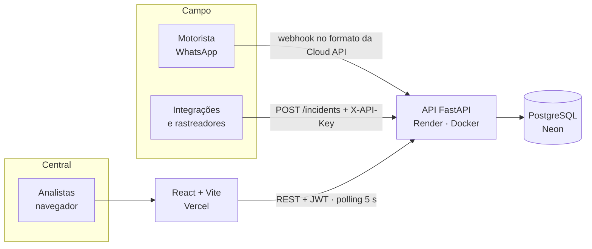

# Logos · Central de Resposta a Incidentes

[](https://github.com/yasmjm/logos/actions/workflows/ci.yml)

MVP do **Logos**, o "cérebro" da central de incidentes de uma transportadora com 5.000 caminhões em rota. Ele organiza o caos de WhatsApp e planilhas numa fila única, priorizada pelo impacto no negócio, em que cada incidente tem dono e nenhum conflito entre analistas corrompe a operação.

| | |
|---|---|
| **Aplicação** | https://logos-five-xi.vercel.app |
| **API (Swagger)** | https://logos-api-0h7z.onrender.com/docs |
| **Vídeo** | [LINK DO VÍDEO] |

---

## Como testar em 2 minutos

1. Abra a [aplicação](https://logos-five-xi.vercel.app) e clique em **Entrar como Ana**. Não precisa de cadastro; as contas de demonstração são `ana` e `bruno`, senha `logos123`.
2. **A fila:** os incidentes chegam ordenados pela pontuação de prioridade (coluna "Prior."). Passe o mouse sobre o número para ver a conta. Clique nos KPIs do topo para filtrar.
3. **Conflito entre analistas:** abra uma **janela anônima**, entre como **Bruno** e abra o mesmo incidente nas duas janelas.
   - Jeito mais confiável: na janela da Ana, clique em **Editar**; na do Bruno, clique em **Assumir**; volte para a Ana e clique em **Salvar**. Aparece o aviso de que o incidente mudou enquanto ela olhava.
4. **Motorista no WhatsApp (simulado):** menu **Demonstração → Simulador do motorista**. Escolha um caminhão, mande "oi" e responda a triagem. O incidente aparece na fila; assuma-o e clique em **Ver conversa com o motorista** para ver o retorno que ele recebeu.
5. **Resiliência:** **Demonstração → Modo caos**. Injete latência e falhas e veja a interface segurar os erros sem perder os dados. O caos **desliga sozinho em 3 minutos**.
6. **Incidentes chegando:** **Demonstração → Simular incidentes**.

> Se os tempos da fila parecerem antigos (a avaliação pode acontecer dias depois da entrega), use **Demonstração → Restaurar dados de demonstração**. Nada é apagado: os incidentes antigos são arquivados e novos são criados com horários relativos a agora.

---

## O problema

<!-- REVISAR: Yasmim, reescreva com as suas palavras -->

O cliente perde milhões por ano porque **reage devagar**: leva horas para agir sobre um pneu furado ou uma estrada bloqueada. A causa não é falta de gente, e sim falta de coordenação: a informação chega **espalhada** (grupos de WhatsApp e planilhas que não se conversam), **sem prioridade** (tudo parece urgente) e **sem dono definido** (dois analistas chamam dois guinchos para o mesmo caminhão, enquanto outro incidente fica esquecido).

Por isso, a métrica que guia o Logos é o **tempo médio de reação (MTTA)**: quanto tempo um incidente espera até alguém assumir. O processo de descoberta completo está em [`docs/discovery.md`](docs/discovery.md).

## A solução

| Causa | O que o Logos faz |
|---|---|
| Informação espalhada | Uma API única de ingestão, alimentada por integrações e por um **chatbot de triagem no WhatsApp**, que entrega o incidente já estruturado |
| Sem prioridade | Uma **pontuação por impacto no negócio** (carga, problema e cliente), com **vítimas sempre no topo**, SLA por criticidade e escalonamento do que está esquecido |
| Sem dono | **Assumir** registra o responsável; um **lock otimista** garante que, se dois analistas agirem ao mesmo tempo, só um vence e o outro vê quem chegou primeiro |

---

## O que o case pede e onde está

| Requisito | Como o Logos resolve | Onde está |
|---|---|---|
| API que recebe e serve incidentes | `POST /incidents` (integrações, com API key), webhook do WhatsApp, `GET /incidents` com filtros e paginação | `backend/app/api/routes/incidents.py`, `channels.py` |
| CRUD com persistência | Criar, ler, editar (`PATCH`), mudar status e arquivar (soft delete) em PostgreSQL, com histórico de auditoria | `backend/app/services/` |
| 100 incidentes priorizados em milissegundos | Ordenação pela pontuação calculada no banco; criticidade sempre com cor **e** ícone **e** rótulo; SLA colorido; marcador "Sem dono há X min"; incidentes com dono em segundo plano | `backend/app/domain/priority.py`, `frontend/src/features/queue/` |
| Gestão por exceção e filtros | Filtros por criticidade, categoria, status e "Meus incidentes", combináveis e sincronizados na URL; KPIs clicáveis | `useQueueFilters.ts`, `KpiBar.tsx` |
| Dois analistas no mesmo incidente | Lock otimista com `version`: o `UPDATE` só acontece se a versão for a que o analista viu; senão, 409 com o estado atual | `backend/app/services/incident_status.py`, ADR 0002 |
| Resiliência e performance | Retry com backoff nas leituras, 503 com `Retry-After`, a interface mantém os últimos dados na tela, polling de 5 s, modo caos para demonstrar | ADR 0002 e 0003 |
| Validação e dados inesperados | Pydantic estrito nos campos essenciais; **localização nunca rejeita** um incidente (o valor original é preservado); erros em `application/problem+json` | `schemas/incident_create.py`, `core/errors.py` |
| Feedback visual | Skeleton, estados vazios, erro com "tentar de novo", botões com "Assumindo…", toasts, indicador "Atualizado há X s" | `frontend/src/features/` |
| Modo claro/escuro | Tokens de design nos dois temas, com escolha salva | `frontend/src/index.css` |
| Segurança básica | JWT para analistas, API key para integrações, rate limit no login, CORS restrito, segredos só por variável de ambiente | ADR 0001 |

---

## Arquitetura



**Backend:** Python 3.12, FastAPI, SQLAlchemy 2 (síncrono), Alembic, Pydantic v2, PostgreSQL, pytest, uv.
**Frontend:** React 19, Vite, TypeScript (strict), TanStack Query, Tailwind, shadcn/ui (Radix), sonner.

Por que cada escolha:

- **FastAPI + Pydantic:** validação declarativa e documentação OpenAPI gerada a partir do mesmo código, então o Swagger nunca fica desatualizado.
- **SQLAlchemy síncrono:** mais simples de ler e testar; o FastAPI executa rotas síncronas num pool de threads, o que basta para o volume do MVP.
- **PostgreSQL:** transações e travas de linha reais, essenciais para o controle de concorrência. A pontuação e as métricas são calculadas no próprio banco.
- **Alembic:** o schema evolui por migrations versionadas; o CI confere que os modelos batem com elas.
- **PyJWT e python-multipart:** as únicas dependências adicionadas no backend. O rate limit e o retry foram escritos à mão, por serem pequenos.
- **TanStack Query:** cache, polling, política de retry e estados de carregamento e erro sem reinventar.
- **shadcn/ui (Radix):** componentes acessíveis (foco, teclado, leitor de tela) que ficam no repositório e usam os nossos tokens.

### Decisões registradas (ADRs)

| ADR | Decisão |
|---|---|
| [0001](docs/adr/0001-rate-limit-em-memoria.md) | Rate limit em memória e leitura segura do IP real atrás do proxy |
| [0002](docs/adr/0002-estrategia-de-resiliencia.md) | Estratégia de resiliência: retry só em leituras, 503 em vez de 500, caos que expira |
| [0003](docs/adr/0003-polling-em-vez-de-sse.md) | Polling de 5 s em vez de SSE/WebSocket, e quando migrar |
| [0004](docs/adr/0004-prioridade-por-impacto-no-negocio.md) | Prioridade por impacto no negócio, com pesos a validar com o cliente |
| [0005](docs/adr/0005-chatbot-de-triagem-no-whatsapp.md) | Chatbot de triagem guiado no WhatsApp, simulado no MVP |

---

## Regras de domínio

### Status e transições

`Aberto → Em Investigação` (assumir) · `Em Investigação → Fechado | Inconclusivo | Aberto` (liberar) · `Fechado | Inconclusivo → Aberto` (reabrir).

- Assumir registra o responsável e, na primeira vez, o `acknowledged_at`, que alimenta o tempo de reação.
- Só o responsável tira um incidente de "Em Investigação" (outro analista recebe 403, com o nome de quem está cuidando).
- "Inconclusivo" exige um motivo de pelo menos 10 caracteres.
- Toda mudança gera um evento na linha do tempo do incidente. Nada é apagado: excluir é arquivar.

### Pontuação de prioridade

```
base      = (2 × carga + 1,5 × problema + 1 × cliente) ÷ 4,5      → 0 a 100
pontuação = base + 1 ponto por minuto sem dono (até +20)          → 0 a 120
```

- **Carga:** perigosa 100 · perecível 90 · alto valor 75 · geral 40 · vazio 10
- **Problema:** categoria × criticidade (ex.: problema mecânico 65/45/20 para Alta/Média/Baixa)
- **Cliente:** estratégico 100 · prioritário 70 · padrão 40
- **Vítimas:** sempre acima de todos, fora da média. Vida humana não entra em média ponderada. Entre vítimas, as sem dono vêm primeiro.
- O bônus de espera congela quando alguém assume, para que incidentes já atendidos não empurrem para baixo os que ainda não têm dono.

A carga e o cliente vêm da **frota**: ao criar o incidente, o sistema copia a carga e o cliente do caminhão naquele momento (a carga muda a cada viagem). O motorista não precisa informar nada disso. Os pesos são uma **hipótese a validar com a operação do cliente** e ficam num único lugar (`app/domain/priority.py`), expostos em `GET /config`.

### SLA e escalonamento

Tempo para alguém assumir: Alta 5 min · Média 15 min · Baixa 30 min. Um incidente Alta, aberto e sem dono há mais de 5 min ganha o marcador "Sem dono há X min". As regras ficam em `app/domain/sla.py` e o frontend as lê de `GET /config`, sem duplicar valores.

### Concorrência: dois analistas no mesmo incidente

Cada incidente tem uma `version`. A mudança de status é **uma única instrução SQL atômica**:

```sql
UPDATE incidents SET status = ..., version = version + 1, ...
WHERE id = :id AND version = :version_vista AND deleted_at IS NULL
  AND status IN (:origens_validas)
```

Se nenhuma linha for afetada, só então a API lê o estado atual para explicar o motivo: 404, **409 com o incidente atual** (quem mudou, para qual status e quando), 403 ou 422. A decisão de escrever nunca depende de uma leitura anterior, o que evita o clássico *check-then-act*.

**A prova:** um teste dispara duas requisições reais e simultâneas, em conexões separadas, para assumir o mesmo incidente. Exatamente uma recebe 200 e a outra 409; o teste passou em 55 execuções seguidas. Trocando temporariamente o código por um *check-then-act* ingênuo, o mesmo teste falha, com as duas requisições recebendo 200.

Na interface, ações disputadas (como assumir) **não usam atualização otimista**: o botão mostra "Assumindo…" e o sucesso só aparece quando o banco confirma. Antes disso, o polling de 5 s já atualiza a tela e evita a maioria dos conflitos.

### Resiliência

- **Banco lento ou fora:** timeouts curtos, retry com backoff só em leituras e 503 com `Retry-After` em vez de 500. Escritas **não** são repetidas pelo servidor; repetir pelo cliente é seguro, porque, se a primeira tentativa tiver sido aplicada, a repetição recebe 409.
- **Na interface:** uma falha de atualização mantém os últimos dados na tela, com o aviso "Mostrando os dados de há X s"; uma ação que falha mostra "Nada foi alterado" com "Tentar de novo".
- **Health:** `/health` (o processo está vivo) e `/ready` (o banco responde). O Render só manda tráfego para uma versão nova quando `/ready` responde.
- **Observabilidade:** cada requisição tem um `X-Request-ID` e gera uma linha de log JSON; o mesmo id aparece nos erros 500 e 503.

### Segurança básica

- **Analistas:** login com JWT (8 horas, um turno). Credencial inválida recebe sempre a mesma mensagem, sem revelar se o usuário existe.
- **Integrações e caminhões:** `X-API-Key`, comparada em tempo constante. Sem chave configurada, a ingestão fica **fechada**.
- **Rate limit:** 5 tentativas de login por minuto por IP e 120 ingestões por minuto por chave, lendo o IP real atrás do proxy de forma que o cliente não consiga forjá-lo (ADR 0001).
- **CORS** só para a origem do frontend; erros nunca expõem detalhes internos; segredos só por variável de ambiente.

---

## Dados simulados no MVP

O que é real: a API, o banco, as regras, a concorrência, a autenticação e o deploy. O que é **simulado**, para que o avaliador consiga testar tudo sem depender de sistemas externos:

| O que | Como é simulado |
|---|---|
| **Incidentes** | `app/seed.py` gera 120 incidentes a partir de 45 modelos de descrição, cada um com a criticidade coerente com o texto ("danos leves no retrovisor" nunca é Alta). Os horários são relativos ao momento da geração, e a distribuição imita uma central bem operada: poucos casos acima do SLA, para que o vermelho signifique algo. A semente aleatória é fixa, então os dados se repetem a cada execução. |
| **Frota e clientes** | 150 caminhões com tipo de carga e cliente **fictícios** (ex.: "Laticínios Vaca Estrela"). Em produção, esses dados viriam do sistema de gestão de transporte (TMS) da empresa. Cerca de 5% dos incidentes usam caminhões fora da frota, para mostrar o aviso "Dados da frota não encontrados". |
| **Motorista no WhatsApp** | O **Simulador do motorista** (menu Demonstração) envia mensagens por uma rota que usa **a mesma máquina de estados e o mesmo service** do webhook real. Cada caminhão tem um telefone fictício. Ligar a Meta de verdade é trocar a porta de entrada, sem mexer na triagem. |
| **Incidentes chegando** | `POST /demo/simulate` cria incidentes aleatórios pelo mesmo caminho da ingestão. |
| **Falhas de rede e banco** | O **modo caos** injeta latência e respostas 503 nas rotas `/incidents`, numa taxa configurável, e expira sozinho em 3 minutos. |
| **Restaurar** | `POST /demo/reset` arquiva os incidentes atuais (com evento de auditoria) e recria os dados com horários de agora. |

As ferramentas de demonstração só existem com `DEMO_MODE=true` e `CHAOS_ENABLED=true`; desligadas, as rotas respondem 404 e o menu nem aparece.

---

## Evolução e escalabilidade

### WhatsApp real (Meta)

O webhook já recebe a mensagem no formato da **WhatsApp Cloud API**. Para produção:

1. Usar **somente a API oficial da Meta** (WhatsApp Business Platform), com número verificado e templates aprovados para mensagens fora da janela de 24 h. Bibliotecas não oficiais, que automatizam o WhatsApp Web, violam os termos de uso e levam ao banimento do número.
2. Validar a assinatura `X-Hub-Signature-256` e responder ao desafio de verificação do webhook.
3. **Deduplicar pelo id da mensagem (`wamid`)**, porque a Meta pode reenviar a mesma mensagem.
4. Enviar as respostas ao motorista pela Graph API, de forma assíncrona (ver filas abaixo).
5. Próximo passo de produto: **áudio**, que é como muitos motoristas se comunicam, com transcrição antes da triagem.

### Filas com RabbitMQ

Hoje tudo acontece dentro da requisição, o que basta para o MVP. Com 5.000 caminhões, entra um **broker de mensagens** como o RabbitMQ:

```mermaid
flowchart LR
    Meta[Webhook Meta] --> API[API]
    Tel[Telemetria dos caminhões] --> API
    API -- publica --> Q1[[whatsapp.inbound]]
    API -- publica --> Q2[[telemetry.events]]
    Q1 --> BOT[Worker da triagem]
    Q2 --> DET[Worker de detecção]
    BOT --> DB[(PostgreSQL)]
    DET --> DB
    DB -. incident.* .-> EX{{exchange de eventos}}
    EX --> RT[Tempo real · SSE]
    EX --> OUT[[whatsapp.outbound]] --> GRAPH[Graph API da Meta]
    EX --> BI[Métricas e BI]
```

- **Absorver picos:** uma tempestade gera centenas de relatos em minutos. A API só valida e publica na fila, e os workers processam no próprio ritmo, sem derrubar o banco.
- **Responder rápido à Meta:** o webhook confirma o recebimento na hora e a triagem acontece no worker.
- **Ordem por conversa:** mensagens do mesmo motorista roteadas para o mesmo consumidor, para a conversa não avançar fora de ordem.
- **Retry e dead-letter:** o envio ao motorista falhou? Nova tentativa com backoff; depois de N falhas, a mensagem vai para uma fila de análise, sem se perder.
- **Eventos de domínio** (`incident.created`, `incident.status_changed`) distribuídos para tempo real, notificações e métricas, sem acoplar esses consumidores à API.
- **Telemetria:** sensores do caminhão (pneu, freio, parada inesperada) criando incidentes **antes de o motorista avisar**.

### Na AWS

O backend já roda em container (Dockerfile multi-stage, usuário não-root, configuração só por variáveis de ambiente) e é stateless (JWT), então a migração não exige mudança de código:

| Parte | Hoje (MVP) | Na AWS |
|---|---|---|
| Frontend | Vercel | S3 + CloudFront |
| API | Render (container) | ECS Fargate atrás de um ALB, com autoscaling (ou App Runner, mais simples) |
| Banco | Neon (Postgres) | RDS PostgreSQL Multi-AZ (ou Aurora) com RDS Proxy |
| Filas | dentro da requisição | Amazon MQ for RabbitMQ (mesmo protocolo) ou SQS + SNS |
| Rate limit e tempo real | em memória | ElastiCache (Redis): contadores compartilhados e pub/sub entre instâncias |
| Segredos | variáveis do Render | Secrets Manager |
| Logs e métricas | stdout em JSON | CloudWatch Logs e métricas (os logs já saem em JSON, com `request_id`) |
| Borda | proxy do Render | AWS WAF e certificados no ACM |

Com a AWS, a operação também pode rodar na região de **São Paulo (sa-east-1)**, mais perto da central e dos dados, o que ajuda na latência e no alinhamento com a LGPD.

### Outros próximos passos

- **Perfis de acesso** (analista e supervisor), por exemplo para restringir quem arquiva um incidente que está com outra pessoa.
- **Tempo real com várias instâncias:** trocar o polling por SSE com Redis pub/sub (ADR 0003).
- **Validar os pesos da prioridade** com a operação do cliente e ajustá-los com dados reais de multas e perdas.

---

## Estrutura do repositório

```
logos/
├── backend/
│   ├── app/
│   │   ├── api/routes/     # rotas HTTP: incidents, auth, channels (WhatsApp), demo, chaos, config, health
│   │   ├── core/           # configuração, banco, erros, segurança, retry, rate limit, observabilidade
│   │   ├── domain/         # regras puras: priority.py, sla.py, triage.py (chatbot)
│   │   ├── models/         # tabelas (SQLAlchemy)
│   │   ├── schemas/        # contratos de entrada e saída (Pydantic)
│   │   ├── services/       # casos de uso: ingestão, status, edição, métricas, frota, WhatsApp
│   │   └── seed.py         # dados de demonstração
│   ├── alembic/versions/   # migrations 0001 a 0006
│   ├── tests/              # pytest, contra PostgreSQL real
│   └── Dockerfile
├── frontend/
│   └── src/
│       ├── api/            # cliente HTTP, sessão, erros, política de retry, tipos
│       ├── features/       # telas: auth, queue, incident, demo, shell
│       ├── components/     # selos e componentes do domínio (ui/ = shadcn)
│       └── lib/            # rótulos, formatação, tema
├── docs/
│   ├── adr/                # decisões de arquitetura
│   └── discovery.md        # problema, personas e hipóteses
├── .github/workflows/ci.yml
├── docker-compose.yml      # PostgreSQL local
└── render.yaml             # deploy do backend
```

---

## Rodar localmente

Pré-requisitos: Docker, [uv](https://docs.astral.sh/uv/) e Node 24+ com pnpm (`corepack enable`).

```bash
# 1. Banco (PostgreSQL 16 na porta 5433)
docker compose up -d

# 2. Backend
cd backend
cp .env.example .env            # opcional: DEMO_MODE=true e CHAOS_ENABLED=true para o menu Demonstração
uv sync
uv run alembic upgrade head
uv run python -m app.seed       # dados de demonstração (apaga os incidentes locais)
uv run uvicorn app.main:app --reload --port 8000

# 3. Frontend (outro terminal)
cd frontend
cp .env.example .env.local      # VITE_API_URL=http://localhost:8000
pnpm install
pnpm dev                        # http://localhost:5173
```

Entre com **Entrar como Ana** ou **Entrar como Bruno** (senha `logos123`). Para testar a ingestão por API, gere uma `INGEST_API_KEY` no `.env` (o comando está no `.env.example`) e use o botão **Authorize** do Swagger em http://localhost:8000/docs.

## Testes e CI

- **Backend:** 330 testes com pytest, contra PostgreSQL real (banco `logos_test`), incluindo o teste de concorrência com duas conexões simultâneas.
  ```bash
  cd backend && uv run pytest
  ```
- **Frontend:** lint (oxlint), typecheck (TypeScript strict) e build.
- **CI (GitHub Actions)**, em cada push e pull request: ruff, formatação, migrations num banco vazio, `alembic check` (modelos iguais às migrations) e a suíte completa; no frontend, lint, typecheck e build.

## Deploy

- **API:** Render, a partir do `render.yaml` (Docker, plano sem hibernação). As migrations rodam antes de cada deploy, e o health check usa `/ready`.
- **Banco:** Neon (PostgreSQL), conexão direta com TLS.
- **Frontend:** Vercel, com `Root Directory = frontend` e a variável `VITE_API_URL`.
- Variáveis de produção (valores só no painel): `DATABASE_URL`, `JWT_SECRET`, `INGEST_API_KEY`, `FRONTEND_ORIGINS`, `APP_ENV=production`, `TRUSTED_PROXY_HOPS=1`, `DEMO_MODE` e `CHAOS_ENABLED`.

---

## Uso de IA

O projeto foi desenvolvido com o **Claude Code** como par de programação. As decisões de produto e de arquitetura (o problema, as personas, a pontuação por impacto, o chatbot de triagem, as regras de concorrência e resiliência) foram tomadas e revisadas por mim, em pull requests pequenos, e estão registradas nos ADRs e no histórico de commits.
